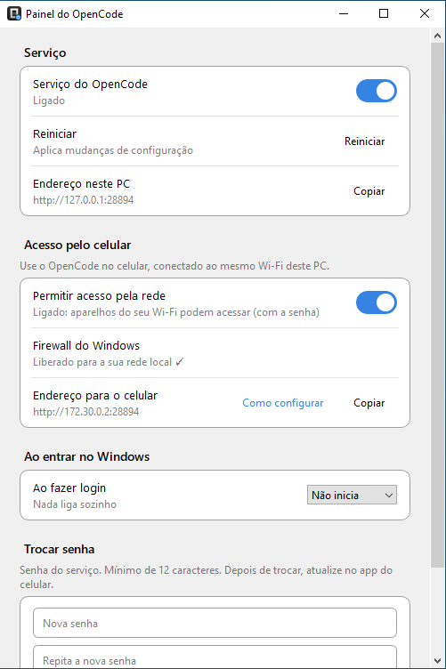
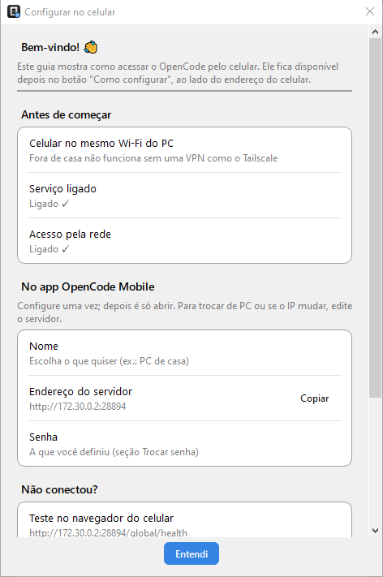
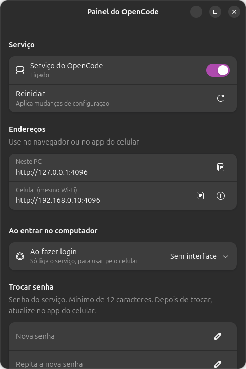
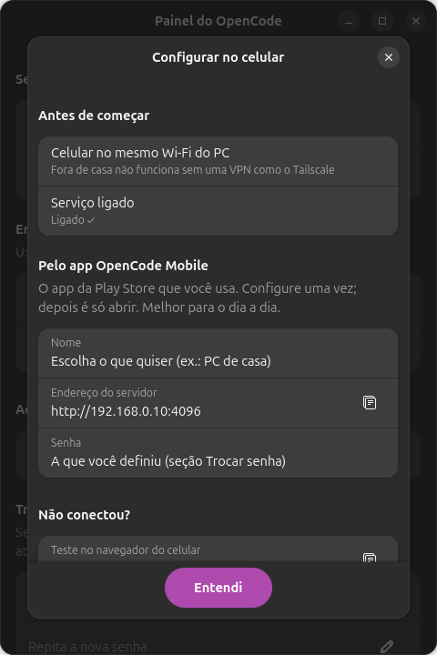

# Painel do OpenCode

Um app pequeno para controlar o **serviço do [OpenCode](https://opencode.ai)** sem usar o terminal,
com versões para **Windows 10/11** e **Linux (GNOME)**.

> Projeto pessoal e **não oficial**: não tem ligação com a equipe do OpenCode.
> O ícone usa o logo do OpenCode com um selo, só para identificar o app.

## O que ele faz

- **Liga, desliga e reinicia** o serviço do OpenCode, mostrando o estado na hora.
- **Acesso pelo celular**: mostra o endereço para usar no app OpenCode Mobile, no mesmo Wi-Fi.
  No Windows, também libera o acesso pela rede e a porta no firewall (só para a rede local).
- **Ao entrar no computador**: abrir o app OpenCode, só ligar o serviço, ou não fazer nada.
- **Troca a senha** do serviço.
- **Guia "Como configurar"** para o celular, que aparece sozinho na primeira vez.

Requer o OpenCode **2.3.0 ou mais novo**.

## Windows

<p align="center">
  
  &nbsp;
  
</p>

1. Baixe `Painel.do.OpenCode.exe` na página **[Releases](../../releases/latest)**.
2. Abra o arquivo. Na primeira vez, o Windows pode mostrar "O Windows protegeu o computador",
   o que acontece com todo app sem assinatura paga: clique em **Mais informações → Executar assim mesmo**.
3. Para usar no celular:
   1. Ligue **Permitir acesso pela rede**.
   2. Em **Firewall do Windows**, clique em **Liberar** e aceite a permissão de administrador.
   3. Se aparecer um alerta do firewall sobre um programa chamado **"Bun"**, clique em
      **Permitir acesso**: é o OpenCode (ele é feito com o Bun).
   4. No app OpenCode Mobile, adicione um servidor com o **endereço para o celular** e a sua senha.

<details>
<summary>O que o app altera no Windows (e como desfazer)</summary>

| O quê | Onde |
|---|---|
| Acesso pela rede e senha do serviço | `service.json`, na pasta de configuração do OpenCode |
| Início automático | atalho `OpenCode - inicio automatico` na pasta *Inicializar* |
| Regra de firewall | `OpenCodePainelCelular` (só a porta do serviço, só a rede local) |
| Estado do painel | `%APPDATA%\OpenCodePainel` |

Para desfazer: desligue o acesso pela rede, escolha "Não inicia", apague a regra
`OpenCodePainelCelular` no Firewall do Windows e a pasta `%APPDATA%\OpenCodePainel`.
</details>

**Gerar o `.exe` a partir do código** (precisa do Python 3), no PowerShell, dentro de `windows/`:

```powershell
powershell -ExecutionPolicy Bypass -File .\gerar-exe.ps1
```

## Linux (GNOME)

<p align="center">
  
  &nbsp;
  
</p>

### Antes de instalar

- O **OpenCode 2.3.0 ou mais novo**, instalado pelo instalador oficial
  (`curl -fsSL https://opencode.ai/install | bash`). O painel usa o OpenCode em `~/.opencode/bin/opencode`.
- Opcional: o **app de desktop do OpenCode**, só para a opção "Com interface" ao entrar no computador.

### Ubuntu, Debian, Linux Mint, Pop!_OS e derivados (`.deb`)

1. Baixe `opencode-painel_1.0_all.deb` na página **[Releases](../../releases/latest)**.
2. Instale pelo terminal, na pasta onde o arquivo foi baixado (o `apt` instala o que mais for preciso):

   ```bash
   cd ~/Downloads
   sudo apt install ./opencode-painel_1.0_all.deb
   ```

   Ou abra o arquivo com dois cliques, se o seu sistema tiver uma central de programas que instale `.deb`.
3. Procure **"Painel do OpenCode"** no menu de aplicativos.

Para desinstalar: `sudo apt remove opencode-painel`.

### Fedora, Arch e outras distribuições

1. Instale as dependências (Python 3, GTK 4 e libadwaita; no GNOME geralmente já vêm instaladas):

   ```bash
   sudo dnf install python3-gobject python3-cairo gtk4 libadwaita        # Fedora
   sudo pacman -S python-gobject python-cairo gtk4 libadwaita            # Arch
   ```

2. Baixe o código e rode o instalador (instala só para o seu usuário, sem `sudo`):

   ```bash
   git clone https://github.com/leosimonato81/painel-do-opencode.git
   cd painel-do-opencode/linux
   ./instalar.sh
   ```

   Sem o `git`, baixe o **Source code (zip)** na página Releases, extraia e rode `./instalar.sh` dentro de `linux/`.
3. Procure **"Painel do OpenCode"** no menu de aplicativos.

Para desinstalar: `./instalar.sh --remover`.

### Acesso pelo celular no Linux

O painel mostra o endereço para o celular, mas o acesso pela rede e o firewall são configurados à parte:

```bash
opencode service set hostname 0.0.0.0
sudo ufw allow from 192.168.0.0/24 to any port <porta> proto tcp   # se usar o ufw
```

Troque `192.168.0.0/24` pela faixa da sua rede e `<porta>` pela porta que o painel mostra.
Depois, reinicie o serviço pelo painel e, no app OpenCode Mobile, adicione um servidor com o
**endereço para o celular** e a sua senha.

**Gerar o `.deb` a partir do código**, dentro de `linux/`: `./gerar-deb.sh 1.0` (o pacote vai para `linux/dist/`).

## Estrutura

```
windows/   app em Python + Qt (PySide6), empacotado como .exe com PyInstaller
linux/     app em Python + GTK 4/libadwaita, com instalador e gerador de .deb
docs/img/  imagens deste README
```

## Licença

[MIT](LICENSE).
